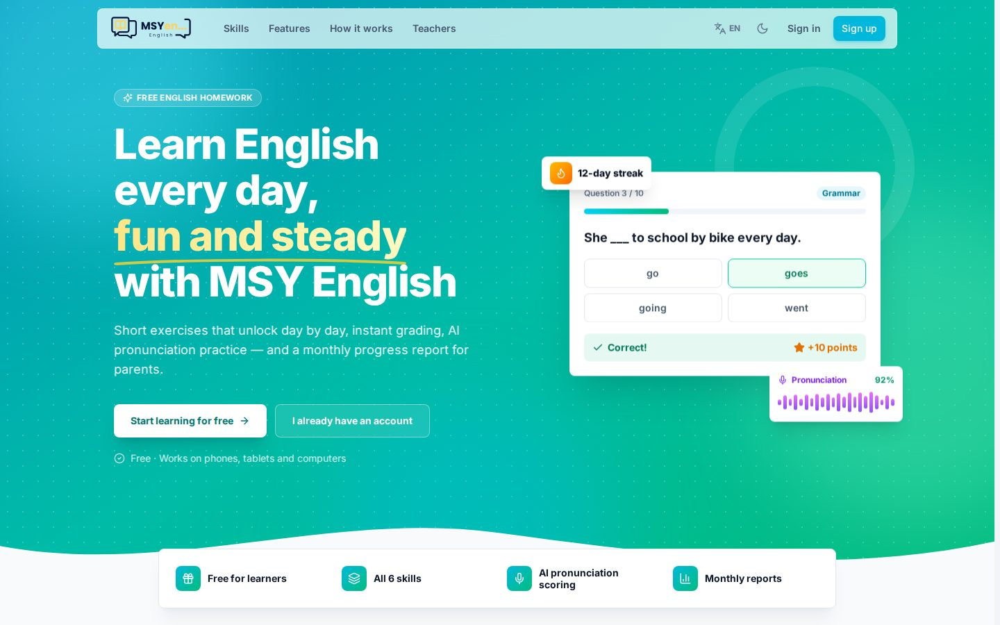
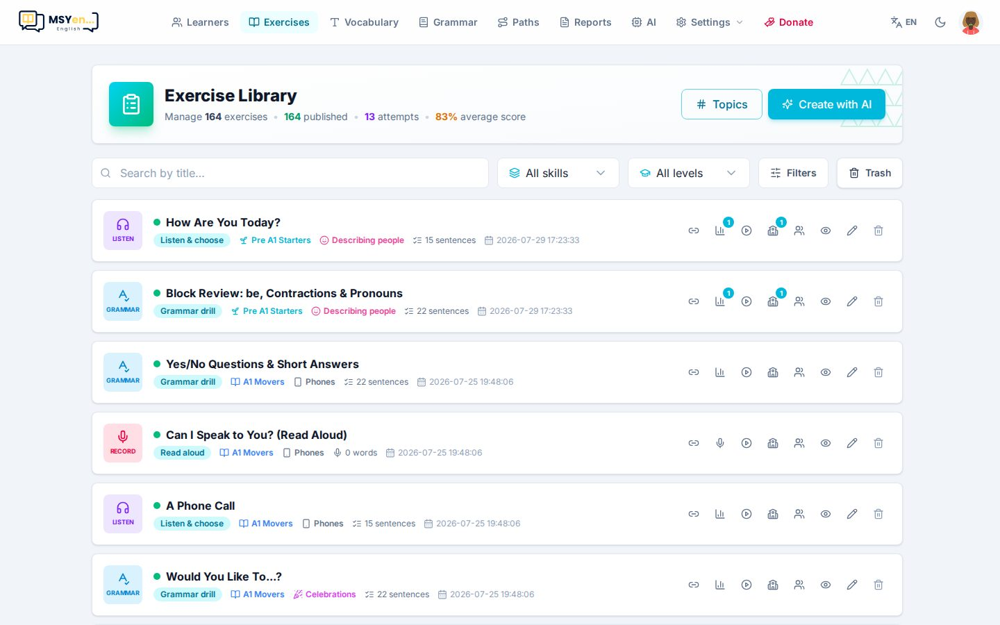
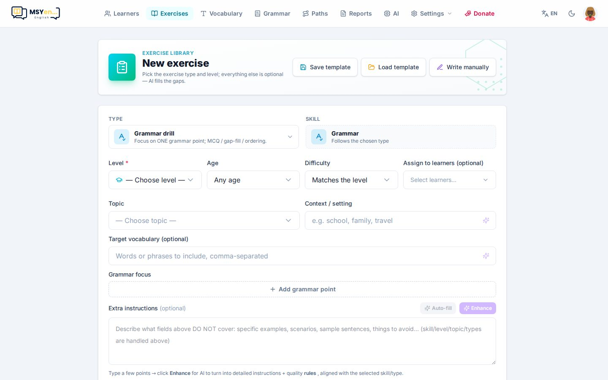
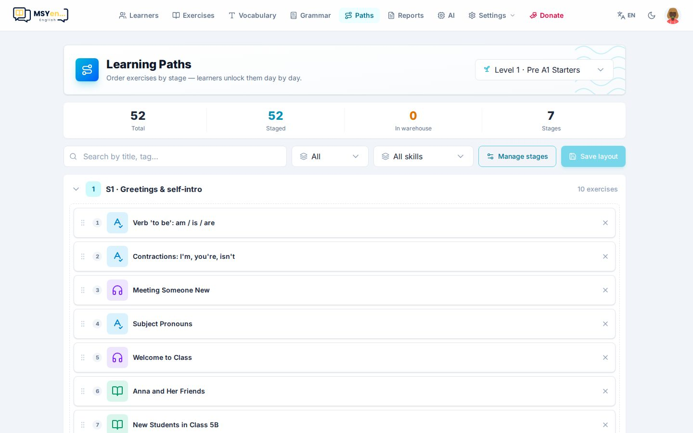
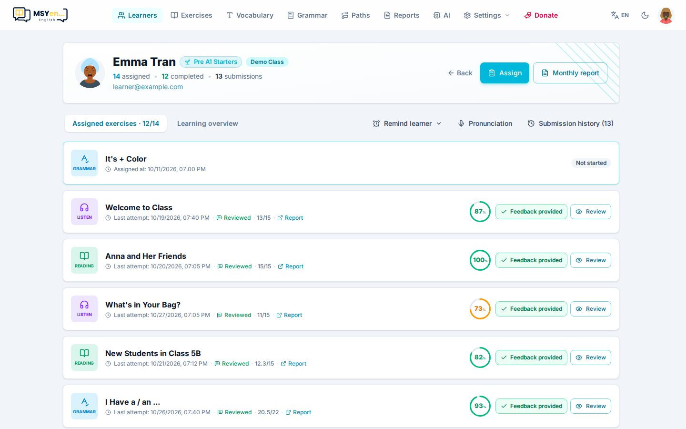
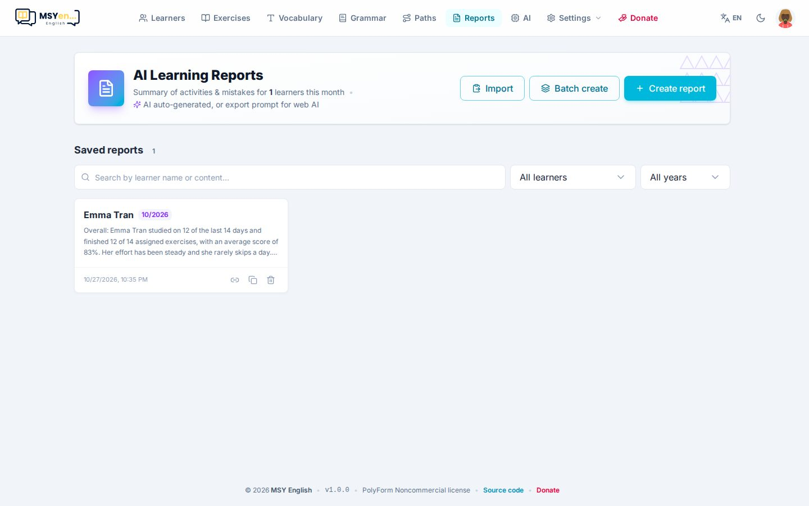
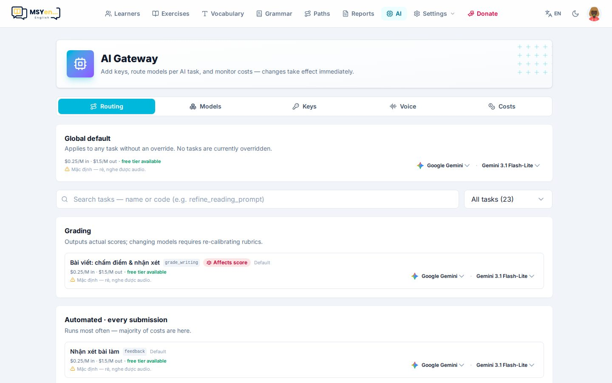
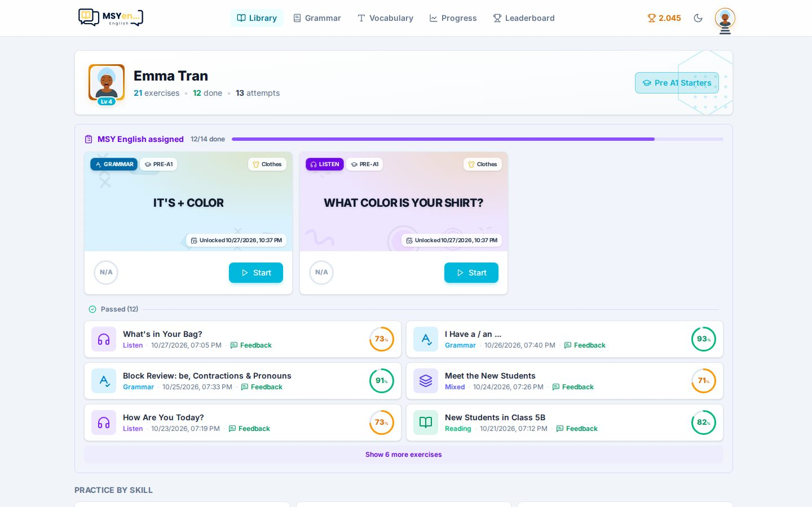
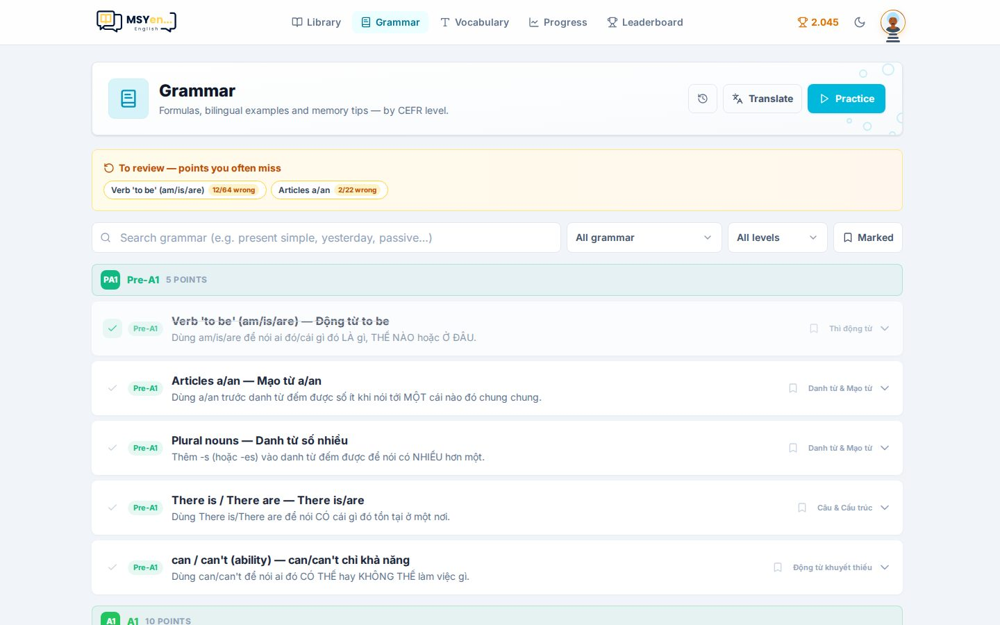

# MSYen Homework

Nền tảng **giao bài và luyện tiếng Anh** cho giáo viên dạy lớp nhỏ / lớp online — miễn phí, mã nguồn mở,
tự cài trên tài khoản Cloudflare của bạn (gói miễn phí đủ cho vài lớp học).



- **Giáo viên** soạn bài (tay hoặc nhờ AI, cả bài nghe/nói từ video YouTube), xếp lộ trình theo cấp độ,
  giao cho lớp, xem từng câu học viên làm, nhận xét và gửi báo cáo tháng cho phụ huynh.
- **Học viên** đăng ký tài khoản, học theo lộ trình mở dần mỗi ngày, làm bài được giao, được chấm và nhận
  xét ngay — kể cả phát âm và bài viết.

## Demo

**[free.msyen.com](https://free.msyen.com)** — thử ngay không cần đăng ký:

- Giáo viên: [free.msyen.com/teacher/login](https://free.msyen.com/teacher/login) · `admin@msyen.com` / `msyen123`
- Học viên (đã có hai tuần học): [free.msyen.com/u/login](https://free.msyen.com/u/login) · `learner@msyen.com` / `msyen123`

## Ảnh chụp

| | |
|---|---|
|  **Thư viện bài** — lọc theo kỹ năng, cấp độ, chủ đề; giao bài một chạm |  **Tạo bài bằng AI** — chọn dạng bài, cấp độ, chủ đề; AI soạn, bạn duyệt |
|  **Lộ trình** — chia chặng, kéo-thả bài, học viên mở dần mỗi ngày |  **Theo dõi từng em** — bài đã làm, lỗi hay gặp, phát âm, lịch sử |
|  **Báo cáo tháng** — AI viết nhận xét, gửi link cho phụ huynh |  **Cổng AI** — nhiều nhà cung cấp, chọn model cho từng việc, xem chi phí |
|  **Góc học viên** — bài được giao, lộ trình, điểm và chuỗi ngày |  **Ngữ pháp** — sổ tay, luyện câu, dịch Việt → Anh |

## Tính năng

| Nhóm | Có gì |
| --- | --- |
| Bài tập | Grammar · Reading · Listening · Vocabulary · Writing · Tổng hợp; 6 dạng câu (trắc nghiệm, điền từ, nối, sắp xếp, phân loại, dịch câu) |
| Nghe & chép, shadowing | Dán link YouTube (chọn được một đoạn) → tự lấy transcript bằng Deepgram, cắt câu, dịch — bấm một nút là có bài; hoặc dùng file audio / phụ đề SRT |
| Đọc to | Chấm phát âm bằng Azure Speech: bài dài chấm trên trình duyệt, từ/câu ngắn chấm ở server |
| Viết | AI chấm theo phong cách giáo viên: Nội dung · Bố cục · Từ vựng · Ngữ pháp (0–100) + nhận xét |
| Từ vựng | Bộ từ của giáo viên, từ riêng của học viên; flashcard + 7 dạng luyện, lịch ôn FSRS |
| Ngữ pháp | Sổ tay điểm ngữ pháp, luyện câu, dịch câu Việt → Anh |
| Lộ trình | Chặng theo cấp độ CEFR, mở dần mỗi ngày |
| Lớp học | Giao bài cho cả lớp, theo dõi tiến độ, báo cáo tháng có link chia sẻ |
| Động lực | Điểm, chuỗi ngày, bảng xếp hạng, mini-game lúc chờ chấm |
| AI | Gemini, OpenAI, Claude, DeepSeek, Grok, OpenRouter; chọn model cho từng tác vụ ngay trong app |
| Hai ngôn ngữ | Giao diện Việt / Anh; giáo viên sửa được mọi câu chữ trong app |

## Cài đặt — một lệnh

Hướng dẫn từng bước cho người mới (tạo tài khoản Cloudflare, bật R2, lấy token, đăng nhập Google…):
**[free.msyen.com/setup](https://free.msyen.com/setup)** — cùng nội dung với [`docs/SETUP.md`](docs/SETUP.md).

Bạn cần **một tài khoản Cloudflare** (miễn phí, đã bật R2) và một **API token** — thay `<TOKEN_CLOUDFLARE>`
bằng token của bạn. Khi mã nguồn còn để riêng tư, thêm `<API_DEPLOY>` (khoá chỉ-đọc một dòng, xin chủ dự án).
Máy chưa có git hay Node.js thì script tự cài; ngoài token, script không hỏi gì thêm.

```bash
# macOS / Linux — mở Terminal
curl -fsSL https://free.msyen.com/install.sh | bash -s -- --key <API_DEPLOY> <TOKEN_CLOUDFLARE>
```

```powershell
# Windows — mở PowerShell
$env:API_DEPLOY = "<API_DEPLOY>"; $env:CF_TOKEN = "<TOKEN_CLOUDFLARE>"; irm https://free.msyen.com/install.ps1 | iex
```

Khi mã nguồn đã công khai thì bỏ phần `--key <API_DEPLOY>` / `$env:API_DEPLOY`. Trang
[free.msyen.com/setup](https://free.msyen.com/setup) có ô tự tạo lệnh này khi bạn dán token.

Tạo token nhanh nhất: dash.cloudflare.com → **Manage Account** → **Account API Tokens** → *Create Token* →
chọn mẫu **Full account and zone access**, hạn **No expiration**. Muốn quyền tối thiểu thì xem
[`docs/SETUP.md`](docs/SETUP.md#cách-chọn-quyền-tối-thiểu-tuỳ-chọn). Chỉ cần đúng dòng token — không cần
Account ID hay các khoá S3 Cloudflare hiện kèm.

Script tự tạo cơ sở dữ liệu, kho file, hàng đợi → build → nạp dữ liệu mẫu → deploy → tạo tài khoản → kiểm
tra app, rồi in địa chỉ (`https://msy-homework.<tên-tài-khoản>.workers.dev`). Dùng domain riêng (đã nằm
trong tài khoản Cloudflare đó): thêm `--domain hoc.truongcuaban.com` vào cuối lệnh.

**Tài khoản mặc định** của mọi bản cài: `admin@msyen.com` / `msyen123` — đăng nhập ở `/teacher/login` rồi
đổi ngay ở **Cài đặt → Tài khoản**. Kèm một học viên demo đã học hai tuần: `learner@msyen.com` / `msyen123`
ở `/u/login`.

| Việc | Lệnh (chạy trong thư mục đã cài, mặc định `english-homework`) |
|---|---|
| Lên bản mới | `pnpm cf:update` — backup dữ liệu, tải bản mới, migrate, deploy; dữ liệu, key, tài khoản giữ nguyên |
| Backup dữ liệu | `pnpm cf:backup` — xuất D1 ra `backups/` và một bản lên R2 |
| Bật đăng nhập Google | `pnpm cf:google <client-id> <client-secret>` |
| Tạo lại học viên demo | `pnpm cf:demo --reset` — `learner@msyen.com` / `msyen123`, lịch sử học hai tuần tới hôm nay |
| Quên mật khẩu giáo viên | `pnpm cf:reset-password` |
| Gắn domain riêng | `pnpm cf:setup --domain hoc.truongcuaban.com` |

Sau khi cài: thêm key AI ở **AI → Key** (Gemini có gói miễn phí; Azure Speech để chấm phát âm; Deepgram để
lấy transcript video) — cách lấy từng key: [`docs/guide/12-api-key.md`](docs/guide/12-api-key.md).
Token và các lựa chọn lúc cài nằm ở `.deploy.env` trong thư mục cài để các lệnh trên dùng lại.
Cách cài tay từng bước: [`docs/DEPLOY.md`](docs/DEPLOY.md).

## Hướng dẫn sử dụng

Bộ hướng dẫn cho giáo viên, có ảnh chụp từng màn hình (cũng mở được trong app: **Cài đặt → Hướng dẫn**):

1. [Bắt đầu](docs/guide/01-bat-dau.md) — đăng nhập, bố cục, ngôn ngữ
2. [Cài đặt](docs/guide/02-cai-dat.md) — thương hiệu, Telegram, tài khoản, văn bản giao diện
3. [Cổng AI](docs/guide/03-cong-ai.md) — key, model, giọng đọc, chi phí
4. [Học viên & lớp](docs/guide/04-hoc-vien-lop.md)
5. [Soạn bài](docs/guide/05-soan-bai.md) — bằng AI hoặc soạn tay, giao bài
6. [Lộ trình](docs/guide/06-lo-trinh.md)
7. [Từ vựng](docs/guide/07-tu-vung.md)
8. [Ngữ pháp](docs/guide/08-ngu-phap.md)
9. [Chấm bài & báo cáo](docs/guide/09-cham-bai-bao-cao.md)
10. [Học viên thấy gì](docs/guide/10-hoc-vien-thay-gi.md)
11. [Câu hỏi thường gặp](docs/guide/11-hoi-dap.md)
12. [Lấy API key cho AI, giọng đọc và phát âm](docs/guide/12-api-key.md)

## Chạy trên máy (cho người phát triển)

Cần Node ≥ 20 và pnpm 9.

```bash
pnpm install
cp apps/api/.dev.vars.example apps/api/.dev.vars   # điền JWT_SECRET (key AI thêm trong app cũng được)
pnpm oss                                              # web http://localhost:5185 · api :8795
```

Lần đầu, `pnpm oss` tự áp migration, nạp dữ liệu mẫu (7 cấp CEFR, cây chủ đề, 35 điểm ngữ pháp, lộ
trình Pre-A1 + A1 với 164 bài, 3 bài video nghe-viết + shadowing) và tạo `teacher@example.com` / `teacher123`.
`pnpm learner:demo` (khi `pnpm oss` đang chạy) tạo thêm học viên `learner@example.com` / `learner123`
có sẵn 2 tuần dữ liệu học. Chi tiết lệnh cho người phát triển: [`CLAUDE.md`](CLAUDE.md).

## Công nghệ

Một **Cloudflare Worker** (Hono) phục vụ cả API lẫn SPA (React + Vite) · **D1** (SQLite, Drizzle) ·
**R2** (audio, ảnh) · **Queues** (chấm bài, sinh bài) · **Azure Speech** (đọc mẫu, chấm phát âm) ·
**Deepgram** (giọng đọc, phiên âm video). Monorepo pnpm: `apps/api`, `apps/web`, `packages/shared`.

## Tài liệu

- [`docs/guide/`](docs/guide/README.md) — hướng dẫn sử dụng cho giáo viên
- [`docs/DEPLOY.md`](docs/DEPLOY.md) — cài lên Cloudflare (một lệnh và cách làm tay)
- [`docs/UPDATING.md`](docs/UPDATING.md) · [`CHANGELOG.md`](CHANGELOG.md) — lên bản mới
- [`docs/OVERVIEW.md`](docs/OVERVIEW.md) — kiến trúc, dữ liệu, phân quyền
- [`docs/AI_GATEWAY.md`](docs/AI_GATEWAY.md) — cấu hình AI
- [`docs/SPEECH.md`](docs/SPEECH.md) — Azure + Deepgram: giọng đọc, chấm phát âm, phiên âm video

## Giấy phép

[PolyForm Noncommercial 1.0.0](LICENSE.md): được dùng, sửa, tự cài miễn phí cho mục đích phi thương mại
(dạy học, trường lớp, cá nhân). **Không** được dùng để bán lại hay thu phí dịch vụ dựa trên phần mềm này.
