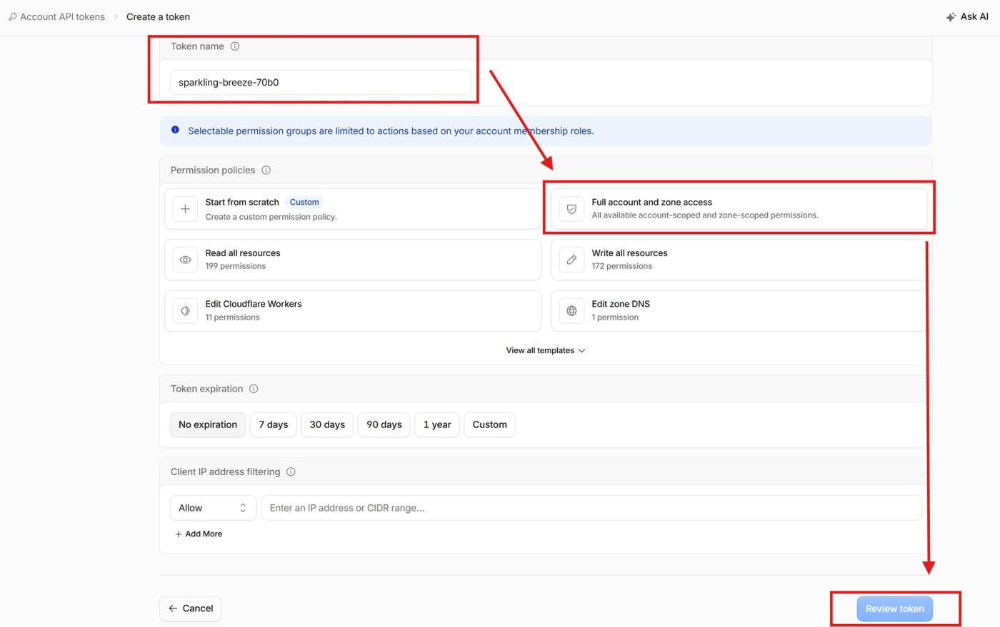

# Cài MSY Homework từ đầu

> [!IMPORTANT]
> **Đây là mã nguồn website, không phải một tài khoản.** Bạn cài app lên tài khoản Cloudflare của chính
> bạn và tự làm chủ toàn bộ: trang web, dữ liệu, học viên, tên miền đều là của bạn. App không phụ thuộc
> vào ai, cũng không phải tài khoản admin hay giáo viên do người khác cấp — không ai khác vào được app của
> bạn.
>
> Bạn hoàn toàn được tự sửa, thêm bớt tính năng, nâng cấp, hoặc fork mã nguồn thành phiên bản riêng.
>
> Để đếm số bản cài, app gửi **duy nhất địa chỉ trang web** của bạn (kèm số phiên bản) về
> `free.msyen.com` khi cài, khi cập nhật và mỗi ngày một lần — không gửi tài khoản, học viên hay bài làm.
> Không muốn gửi: thêm `--no-telemetry` vào cuối lệnh cài, hoặc chạy `pnpm cf:setup --update --no-telemetry`
> sau khi cài.

Trang này dành cho giáo viên muốn có trang web bài tập của riêng mình. Bạn không cần biết lập trình,
không cần thuê máy chủ. App chạy trên Cloudflare, gói miễn phí đủ cho một lớp học nhỏ.

Bạn chỉ cần hai thứ: **một tài khoản Cloudflare** và **một API token** (một chuỗi ký tự cho phép script
cài đặt thay bạn). Phần còn lại script tự làm.

## Bước 1 — Tạo tài khoản Cloudflare

1. Mở [dash.cloudflare.com/sign-up](https://dash.cloudflare.com/sign-up).
2. Nhập email và mật khẩu, bấm **Sign up**.
3. Mở hộp thư, bấm vào liên kết xác nhận Cloudflare vừa gửi.
4. Quay lại trang Cloudflare. Nếu được hỏi muốn làm gì trước, bạn có thể bỏ qua — không cần thêm tên
   miền hay chọn gói trả phí.

## Bước 2 — Bật R2 (kho lưu file)

App lưu file âm thanh và hình ảnh trong **R2**, kho lưu trữ của Cloudflare. R2 có gói miễn phí (10 GB),
nhưng phải bật một lần trong dashboard. Cloudflare thường yêu cầu có sẵn một phương thức thanh toán
(thẻ hoặc PayPal) trước khi bật. **Trong mức miễn phí, bạn không bị trừ tiền.**

### Thêm phương thức thanh toán

1. Trên [dash.cloudflare.com](https://dash.cloudflare.com), ở thanh bên trái, mở **Manage Account** →
   **Billing**.
2. Mở mục **Payment info** (thông tin thanh toán).
3. Thêm thẻ hoặc PayPal, rồi lưu.

### Bật R2

1. Ở thanh bên trái, mở **Storage & databases** → **R2 Object Storage**.
2. Bấm nút bắt đầu (thường là **Get started** hoặc **Purchase R2 Plan**).
3. Đi hết các bước xác nhận gói R2 miễn phí. Giá hiện trên màn hình là 0 đồng cho phần trong mức miễn phí.

> Quên bước này cũng không sao: khi chạy cài đặt, nếu R2 chưa bật, script in ra đường link thẳng tới
> trang R2 và chờ. Bạn bật R2, quay lại cửa sổ lệnh, bấm **Enter** — script chạy tiếp.

## Bước 3 — Tạo API token

Token là "chìa khoá" cho phép script cài đặt thay bạn. Có hai cách — người mới nên dùng **cách nhanh**.

### Cách nhanh — quyền đầy đủ

1. Trên [dash.cloudflare.com](https://dash.cloudflare.com), vào **Manage Account** → **Account API Tokens**
   (hoặc **biểu tượng hồ sơ** góc trên bên phải → **My Profile** → **API Tokens**), bấm **Create Token**.
2. Ở ô **Token name**, đặt tên dễ nhớ, ví dụ `MSY Homework`.
3. Ở mục **Permission policies**, chọn ô **Full account and zone access**.
4. Ở mục **Token expiration**, để **No expiration** (token không hết hạn — các lệnh cập nhật sau này dùng lại nó).
5. Bấm **Review token**, rồi **Create token**.
6. Bấm nút sao chép để chép **token**. Dán tạm vào một ghi chú — Cloudflare chỉ hiện token **một lần**.



> [!WARNING]
> **Chỉ cần chép đúng một dòng: dòng token** (thường bắt đầu bằng `cfat_` — đó là bình thường). Trang kết
> quả của Cloudflare có thể hiện thêm *Access Key ID*, *Secret Access Key*, *S3 endpoint* hay **Account
> ID** — **đừng chép những dòng đó**, app không dùng (script tự tìm Account ID).

Token quyền đầy đủ làm được mọi việc trên tài khoản Cloudflare (kể cả gắn tên miền riêng), nên **giữ kín như
mật khẩu** và đừng gửi cho ai ngoài máy bạn cài.

Hai mục dưới đây là **hướng dẫn phụ** — người mới bỏ qua, đi thẳng tới Bước 4.

<details>
<summary>Cách chọn quyền tối thiểu (tuỳ chọn)</summary>

### Cách chọn quyền tối thiểu (tuỳ chọn)

Muốn token chỉ có đúng những quyền app cần: ở bước 3 trên chọn **Start from scratch** (hoặc ở trang
**API Tokens** cũ: **Create Custom Token** → **Get started**), rồi thêm đủ 5 dòng dưới đây — mỗi dòng có
ba ô chọn, bấm **+ Add more** để thêm dòng:

| Ô 1 | Ô 2 | Ô 3 |
|---|---|---|
| **Account** | **Workers Scripts** | **Edit** |
| **Account** | **D1** | **Edit** |
| **Account** | **Workers R2 Storage** | **Edit** |
| **Account** | **Queues** | **Edit** |
| **Account** | **Account Settings** | **Read** |

Ở mục **Account Resources**, chọn **Include** → tên tài khoản của bạn, rồi tạo token và chép như trên —
vẫn **chỉ chép dòng token**, giữ kín như mật khẩu.

</details>

<details>
<summary>Nếu muốn dùng tên miền riêng (tuỳ chọn)</summary>

### Nếu muốn dùng tên miền riêng

Mặc định app có địa chỉ miễn phí dạng `https://msy-homework.<tên-tài-khoản>.workers.dev`. Muốn dùng tên
miền riêng (ví dụ `hoc.truongcuaban.com`), tên miền đó phải **đã được thêm vào cùng tài khoản Cloudflare**.
Token **quyền đầy đủ** đã đủ quyền; nếu dùng cách quyền tối thiểu thì thêm hai dòng nữa:

| Ô 1 | Ô 2 | Ô 3 |
|---|---|---|
| **Zone** | **DNS** | **Edit** |
| **Zone** | **Workers Routes** | **Edit** |

và ở mục **Zone Resources**, chọn **Include** → **Specific zone** → tên miền của bạn.

</details>

## Bước 4 — Chạy lệnh cài đặt

Script tự cài những gì máy còn thiếu (git, Node), tải code của app vào thư mục **english-homework** ngay
chỗ cửa sổ lệnh đang đứng (mở cửa sổ mới thì đó là thư mục người dùng), rồi làm mọi việc còn lại. Nó
**không hỏi gì thêm**.
Lệnh cần hai thứ — phần **tô vàng** trong lệnh là chỗ bạn thay:

| Chỗ cần thay | Là gì | Lấy ở đâu |
|---|---|---|
| `<TOKEN_CLOUDFLARE>` | API token Cloudflare, dạng `cfat_…` | Bước 3 ở trên |
| `<API_DEPLOY>` | Khoá chỉ-đọc để tải mã nguồn — **chỉ cần khi mã nguồn còn để riêng tư** | Xin chủ dự án (một dòng dài) |

Trên trang [free.msyen.com/setup](https://free.msyen.com/setup), ô **Tạo lệnh cài** ngay dưới đây tự điền
lệnh khi bạn dán token — chỉ việc bấm **Copy**.

<!-- install-builder -->

### macOS hoặc Linux

1. Mở **Terminal** (trên Mac: bấm Cmd + Space, gõ `Terminal`, bấm Enter).
2. Dán lệnh dưới đây (đã thay phần tô vàng), rồi bấm Enter:

```bash
curl -fsSL https://free.msyen.com/install.sh | bash -s -- --key <API_DEPLOY> <TOKEN_CLOUDFLARE>
# ví dụ:
curl -fsSL https://free.msyen.com/install.sh | bash -s -- --key LS0tLS1CRUdJTiBPUEVOU1NI… cfat_Ab12Cd34Ef56Gh78…
```

Khi mã nguồn đã công khai thì bỏ phần `--key <API_DEPLOY>`. Dùng tên miền riêng: thêm `--domain` vào cuối:

```bash
curl -fsSL https://free.msyen.com/install.sh | bash -s -- --key <API_DEPLOY> <TOKEN_CLOUDFLARE> --domain <TEN_MIEN>
# ví dụ:
curl -fsSL https://free.msyen.com/install.sh | bash -s -- --key LS0tLS1CRUdJTiBPUEVOU1NI… cfat_Ab12Cd34Ef56Gh78… --domain hoc.truongcuaban.com
```

### Windows

1. Bấm **Start**, gõ `PowerShell`, mở **Windows PowerShell**.
2. Dán lệnh dưới đây (đã thay phần tô vàng), rồi bấm Enter:

```powershell
$env:API_DEPLOY = "<API_DEPLOY>"; $env:CF_TOKEN = "<TOKEN_CLOUDFLARE>"; irm https://free.msyen.com/install.ps1 | iex
# ví dụ:
$env:API_DEPLOY = "LS0tLS1CRUdJTiBPUEVOU1NI…"; $env:CF_TOKEN = "cfat_Ab12Cd34Ef56Gh78…"; irm https://free.msyen.com/install.ps1 | iex
```

Dùng tên miền riêng: thêm `$env:CF_DOMAIN = "<TEN_MIEN>";` trước `irm`. Trên Windows, script cài Git và
Node bằng **winget** — nếu Windows hỏi quyền, bấm **Yes**.

### Script làm những gì

Bạn chỉ cần chờ vài phút. Script lần lượt:

1. Tìm tài khoản Cloudflare của bạn.
2. Tạo địa chỉ miễn phí `https://msy-homework.<tên-tài-khoản>.workers.dev`.
3. Tạo cơ sở dữ liệu (D1), kho lưu file (R2) và hàng đợi (Queues).
4. Đóng gói app và nạp nội dung mẫu: 7 cấp độ CEFR, 164 bài tập trên lộ trình và 3 bài video nghe-viết + shadowing.
5. Đưa app lên mạng, tạo tài khoản giáo viên mặc định, rồi kiểm tra trang đã chạy.
6. Tạo một [học viên demo](#học-viên-demo) đã có hai tuần học để bạn thử phần học viên ngay.

Cuối cùng script in ra địa chỉ trang web. Chạy lại script nhiều lần cũng an toàn — phần nào đã có thì
được giữ nguyên.

Tài khoản chưa bật **Analytics Engine**? Script tự xử lý, bạn không cần làm gì.

### Giữ lại thư mục cài đặt

Script tải mã nguồn (code) của app về một thư mục tên **english-homework**, đặt ngay chỗ cửa sổ lệnh đang
đứng — mở Terminal / PowerShell mới thì đó là thư mục người dùng của bạn:

| Máy | Thư mục cài đặt |
|---|---|
| macOS | `/Users/<tên-máy>/english-homework` |
| Linux | `/home/<tên-máy>/english-homework` |
| Windows | `C:\Users\<tên-máy>\english-homework` |

Mọi thông tin cài đặt (token, tên app, mật khẩu ban đầu) nằm trong file `.deploy.env` ở thư mục đó.
**Đừng xoá thư mục này** — các lệnh cập nhật, sao lưu, đặt lại mật khẩu bên dưới đều phải chạy **bên trong**
nó. Lệnh `cd` (change directory) là "đi vào thư mục"; mỗi lần mở cửa sổ lệnh mới, gõ nó trước tiên:

```bash
# đi vào thư mục code đã cài (dấu ~ là thư mục người dùng — dùng được cả trên Windows PowerShell)
cd ~/english-homework
```

Các khối lệnh bên dưới đã có sẵn dòng `cd` này ở đầu — copy cả khối là chạy được.

## Sau khi cài xong

1. **Đăng nhập**: mở `<địa chỉ trang>/teacher/login`, đăng nhập bằng
   [tài khoản mặc định](#tài-khoản-mặc-định).
2. **Đổi email và mật khẩu ngay**: **Cài đặt** (*Settings*) → **Tài khoản** (*Account*).
3. **Thêm key AI**: mở **AI** → tab **Key**. Cách dán key xem ở [Cổng AI](guide/03-cong-ai.md); cách lấy key
   từng nhà cung cấp xem ở [Lấy API key](guide/12-api-key.md).
4. **Đặt thương hiệu**: **Cài đặt** (*Settings*) → **Thương hiệu** (*Brand*) — tên app, logo, xưng **Cô**
   hay **Thầy**.
5. **Thử phần học viên**: mở `<địa chỉ trang>/u/login`, đăng nhập bằng [học viên demo](#học-viên-demo).

## Cập nhật bản mới

Trong thư mục cài đặt, chạy:

```bash
# đi vào thư mục code đã cài (bỏ qua nếu đã ở trong đó)
cd ~/english-homework
pnpm cf:update
```

Lệnh này sao lưu cơ sở dữ liệu trước, rồi tải bản mới, cập nhật cơ sở dữ liệu và đưa lên mạng. Dữ liệu,
key AI và tài khoản đều được giữ nguyên.

### Những tuỳ chỉnh của bạn có bị mất không?

Không. Những gì chỉnh trong app đều nằm trong cơ sở dữ liệu, cập nhật không đụng tới: tên app, logo,
cách xưng cô/thầy, bật hay tắt trang chủ (**Cài đặt**), mọi chữ trên giao diện kể cả trang chủ
(**Cài đặt → Văn bản giao diện**), key AI, bài tập, lớp và học viên.

Nếu bạn (hoặc người giúp bạn) sửa thẳng vào code trong thư mục cài đặt, lệnh cập nhật tự lưu các chỗ sửa
đó rồi đặt lại lên bản mới. Chỉ khi bản mới cũng sửa đúng dòng đó, lệnh mới dừng lại, báo tên file và
**không cập nhật gì** — app vẫn chạy bản cũ. Khi đó, muốn bỏ chỗ sửa riêng và lấy bản mới:

```bash
# đi vào thư mục code đã cài (bỏ qua nếu đã ở trong đó)
cd ~/english-homework
pnpm cf:update --reset
```

Muốn đổi chữ, nên dùng **Cài đặt → Văn bản giao diện** thay vì sửa code — cách này không bao giờ vướng khi cập nhật.

## Sao lưu và khôi phục

Sao lưu bất cứ lúc nào:

```bash
# đi vào thư mục code đã cài (bỏ qua nếu đã ở trong đó)
cd ~/english-homework
pnpm cf:backup
```

Toàn bộ cơ sở dữ liệu được xuất ra file `backups/<tên>.sql` trong thư mục cài đặt, kèm một bản sao trong
R2 (mục `backups/d1/`).

Khôi phục (nếu chưa chắc, hãy nhờ người rành kỹ thuật):

**Trong vài ngày gần đây** — D1 Time Travel đưa cơ sở dữ liệu về đúng một thời điểm (giờ quốc tế, dạng ISO).
Tên cơ sở dữ liệu mặc định là `msy_homework`:

```bash
cd ~/english-homework/apps/api
npx wrangler d1 time-travel restore msy_homework --timestamp=<THOI_DIEM> --config wrangler.prod.local.toml
# ví dụ: về 15 giờ ngày 20/10/2026 giờ Việt Nam (= 08:00 giờ quốc tế)
npx wrangler d1 time-travel restore msy_homework --timestamp=2026-10-20T08:00:00Z --config wrangler.prod.local.toml
```

**Lâu hơn** — nạp file `.sql` đã sao lưu vào một cơ sở dữ liệu D1 mới:

```bash
cd ~/english-homework/apps/api
npx wrangler d1 execute <TEN_DB_MOI> --remote --file=<FILE_SQL> --config wrangler.prod.local.toml
# ví dụ:
npx wrangler d1 execute msy_homework_khoiphuc --remote --config wrangler.prod.local.toml --file=../../backups/msy_homework-2026-10-20T08-00-00.sql
```

## Quên mật khẩu

Trong thư mục cài đặt, chạy:

```bash
# đi vào thư mục code đã cài (bỏ qua nếu đã ở trong đó)
cd ~/english-homework
pnpm cf:reset-password
```

Lệnh in ra mật khẩu mới. Muốn tự đặt email và mật khẩu:

```bash
# đi vào thư mục code đã cài (bỏ qua nếu đã ở trong đó)
cd ~/english-homework
pnpm cf:reset-password <EMAIL> '<MAT_KHAU_MOI>'
# ví dụ:
pnpm cf:reset-password admin@msyen.com 'Lop5B-2026'
```

## Cho học viên đăng nhập bằng Google

Không bắt buộc. Làm xong, trang đăng nhập học viên có thêm nút **Đăng nhập với Google**.

Trước tiên, chạy lệnh này trong thư mục cài đặt để xem hai địa chỉ cần dán vào Google:

```bash
# đi vào thư mục code đã cài (bỏ qua nếu đã ở trong đó)
cd ~/english-homework
pnpm cf:google
```

Lệnh in ra hai dòng (giữ cửa sổ này mở):

- **Authorized JavaScript origins**: địa chỉ app, ví dụ `https://msy-homework.abc.workers.dev`
- **Authorized redirect URIs**: địa chỉ app + `/api/v1/account/oauth/google/callback`

### Tạo ứng dụng trên Google Cloud

1. Mở [console.cloud.google.com](https://console.cloud.google.com), đăng nhập tài khoản Google.
2. Ở thanh trên cùng, bấm ô chọn dự án → **New project**. Đặt tên (ví dụ `MSY Homework`), bấm **Create**.
   Chờ tạo xong rồi chọn dự án đó.
3. Ở ô tìm kiếm trên cùng, gõ `Google Auth Platform` và mở nó (ở một số tài khoản mục này vẫn tên là
   **OAuth consent screen**). Bấm **Get started**.
4. Điền **App name** (tên trường hoặc tên app), **User support email** (email của bạn), **Audience** chọn
   **External**, **Contact information** (email của bạn). Đồng ý điều khoản, bấm **Create**.
5. Vào mục **Audience**, bấm **Publish app** và xác nhận — để mọi học viên có tài khoản Google đều đăng
   nhập được (nếu không, chỉ những email bạn thêm làm người thử mới vào được).
6. Vào mục **Clients** (hoặc **Credentials**), bấm **Create client** (hoặc **Create credentials** →
   **OAuth client ID**).
7. **Application type**: chọn **Web application**. Đặt tên tuỳ ý.
8. Ở **Authorized JavaScript origins**, bấm **Add URI**, dán dòng địa chỉ app.
9. Ở **Authorized redirect URIs**, bấm **Add URI**, dán dòng có `/api/v1/account/oauth/google/callback`.
10. Bấm **Create**. Google hiện **Client ID** và **Client secret** — chép cả hai ngay (Client secret có thể
    chỉ hiện đầy đủ một lần).

### Dán vào app

Quay lại cửa sổ lệnh đang chờ, dán **Client ID** rồi **Client secret** khi được hỏi. Hoặc chạy một lệnh:

```bash
# đi vào thư mục code đã cài (bỏ qua nếu đã ở trong đó)
cd ~/english-homework
pnpm cf:google <CLIENT_ID> <CLIENT_SECRET>
# ví dụ:
pnpm cf:google 123456789012-abc123def456.apps.googleusercontent.com GOCSPX-AbCdEfGhIjKlMnOpQrStUv
```

Google có thể cần vài phút để nhận địa chỉ mới. Muốn tắt đăng nhập Google:

```bash
# đi vào thư mục code đã cài (bỏ qua nếu đã ở trong đó)
cd ~/english-homework
pnpm cf:google --off
```

## Thêm tên miền riêng về sau

Đã cài bằng địa chỉ `workers.dev` và giờ muốn dùng tên miền riêng? Tên miền phải nằm trong cùng tài khoản
Cloudflare. Token **quyền đầy đủ** đã đủ quyền; token quyền tối thiểu thì cần thêm hai quyền **Zone** như ở
[Bước 3](#nếu-muốn-dùng-tên-miền-riêng). Rồi chạy:

```bash
# đi vào thư mục code đã cài (bỏ qua nếu đã ở trong đó)
cd ~/english-homework
pnpm cf:setup --domain <TEN_MIEN>
# ví dụ:
pnpm cf:setup --domain hoc.truongcuaban.com
```

## Tài khoản mặc định

Mỗi bản cài mới có đúng **một** tài khoản giáo viên:

- Email: `admin@msyen.com`
- Mật khẩu: `msyen123`

Ai biết trang này cũng biết tài khoản trên, nên **hãy đổi ngay sau lần đăng nhập đầu tiên**: **Cài đặt**
(*Settings*) → **Tài khoản** (*Account*) — đổi email, rồi đổi mật khẩu.

Quên mật khẩu đã đổi? Chạy `pnpm cf:reset-password` trong thư mục cài đặt (xem
[Quên mật khẩu](#quên-mật-khẩu)).

### Học viên demo

Bản cài mới cũng có sẵn một **học viên demo** đã học khoảng hai tuần — có lớp, bài được giao, bài đã làm,
từ vựng, ngữ pháp, chuỗi ngày học và báo cáo tháng — để thử ngay phần học viên mà không phải tự đăng ký
rồi làm bài:

- Email: `learner@msyen.com`
- Mật khẩu: `msyen123`
- Đăng nhập ở `<địa chỉ trang>/u/login`

Giáo viên thấy học viên này trong lớp **Demo Class**. Thử xong có thể xoá ở **Học viên**. Muốn tạo lại (ngày
học mới nhất là hôm nay), hoặc bản cài cũ chưa có học viên demo:

```bash
# đi vào thư mục code đã cài (bỏ qua nếu đã ở trong đó)
cd ~/english-homework
pnpm cf:demo --reset
```

Không muốn tạo học viên demo khi cài: thêm `--no-demo` vào cuối lệnh cài.
