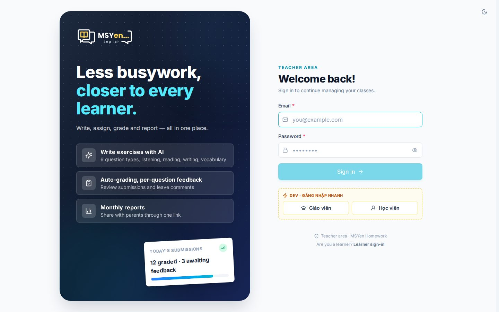
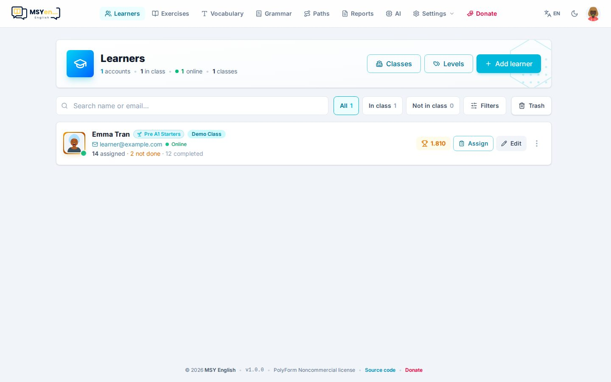
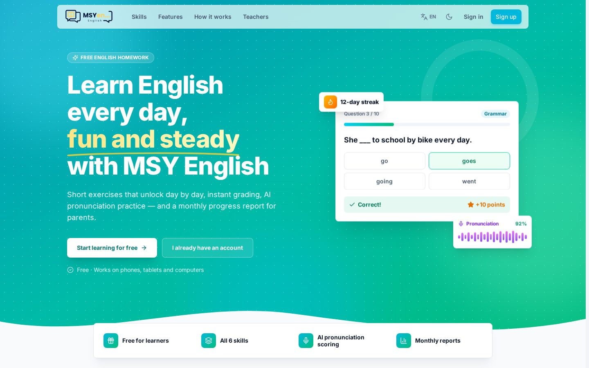

# 1. Bắt đầu

## Đăng nhập

Tài khoản giáo viên được tạo bằng lệnh (chạy một lần lúc cài đặt):

```bash
pnpm teacher:create <email> <mật-khẩu> [tên]
```

Sau đó mở **`/teacher/login`** và đăng nhập bằng email, mật khẩu đó. Đổi email hoặc mật khẩu về sau ở
**Cài đặt → Tài khoản** ([xem phần 2](02-cai-dat.md#tài-khoản)).



## Bố cục khu giáo viên

Thanh trên cùng có đủ các mục quản trị:

| Mục | Dùng để |
|---|---|
| **Học viên** (*Learners*) | Danh sách học viên, cấp độ, lớp học, tiến độ từng em |
| **Bài tập** (*Exercises*) | Thư viện bài, tạo bài bằng AI hoặc soạn tay, giao bài |
| **Từ vựng** (*Vocabulary*) | Bộ từ vựng cho học viên luyện thẻ |
| **Ngữ pháp** (*Grammar*) | Sổ tay ngữ pháp, câu drill, câu dịch |
| **Lộ trình** (*Paths*) | Sắp bài theo chặng, học viên mở dần mỗi ngày |
| **Báo cáo** (*Reports*) | Báo cáo học tập tháng cho phụ huynh |
| **AI** | Key, model, giọng đọc, chi phí |
| **Cài đặt** (*Settings*) | Cài đặt chung, Văn bản giao diện, Hướng dẫn |
| **Ủng hộ** (*Donate*) | Ủng hộ dự án |

Bên phải là nút đổi **ngôn ngữ** (VI/EN — chỉ đổi cho bạn), **sáng/tối** và **ảnh đại diện** (đăng xuất).
Cuối mỗi trang là footer với phiên bản đang chạy.



## Ngôn ngữ giao diện

App có hai ngôn ngữ: tiếng Việt và tiếng Anh.

- **Ngôn ngữ mặc định cho mọi người** đặt ở Cài đặt → Thương hiệu.
- Mỗi người (giáo viên, học viên) tự đổi cho mình bằng nút VI/EN trên thanh trên cùng.
- Muốn sửa câu chữ của app theo ý mình: Cài đặt → **Văn bản giao diện** ([phần 2](02-cai-dat.md#văn-bản-giao-diện)).

## Trang chủ công khai

Địa chỉ gốc của app (`/`) mở **trang chủ** giới thiệu cho học viên và phụ huynh, có nút **Đăng ký** và
**Đăng nhập**. Trang này luôn xem được ở `/home`.



Không muốn dùng trang chủ? Tắt **Dùng trang chủ làm trang mở đầu** ở Cài đặt → Thương hiệu — khi đó `/`
mở thẳng trang đăng nhập của học viên. Câu chữ trên trang chủ sửa được ở Văn bản giao diện (nhóm `home`).
