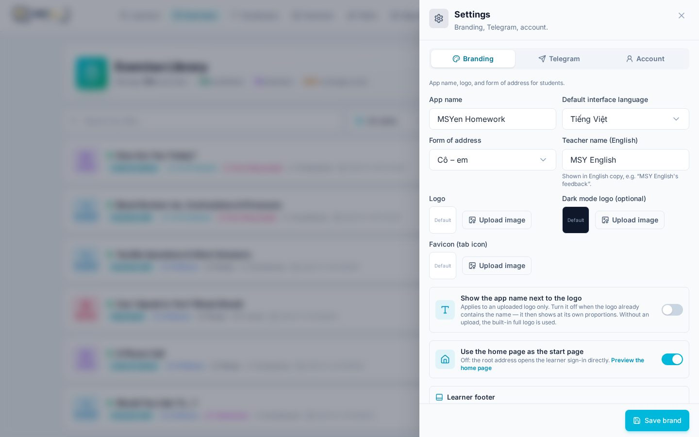
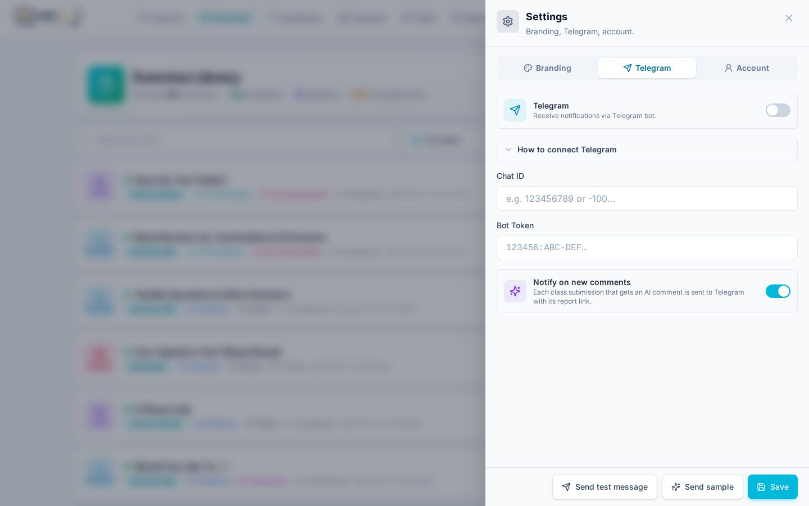
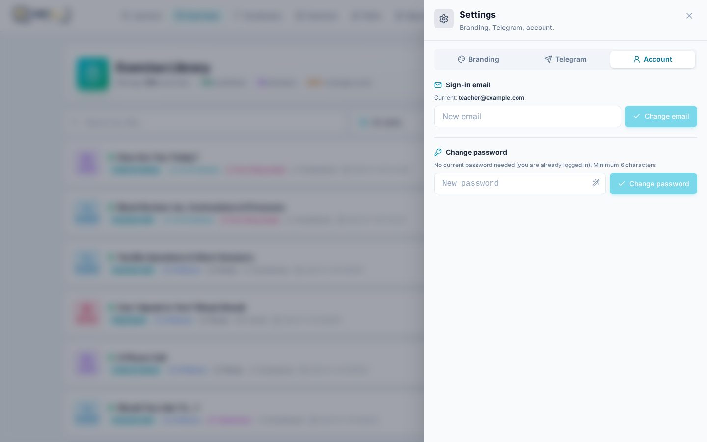
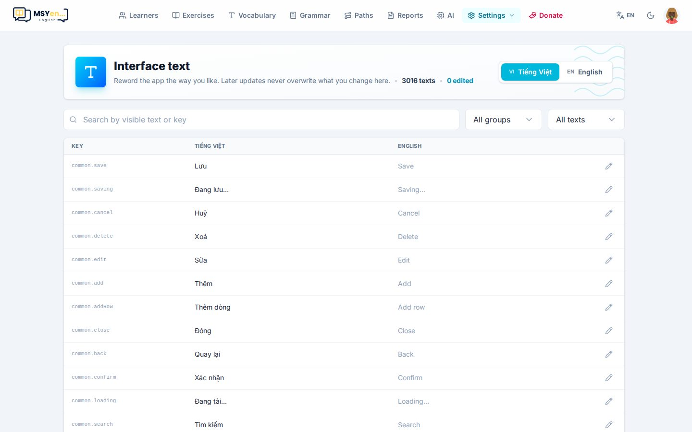

# 2. Cài đặt

Mở **Cài đặt** (*Settings*) trên thanh trên cùng → **Cài đặt chung** (*General settings*). Drawer có ba tab.

## Thương hiệu

| Mục | Ý nghĩa |
|---|---|
| **Tên app** (*App name*) | Hiện trên tab trình duyệt, email, trang chủ |
| **Ngôn ngữ mặc định** (*Default interface language*) | Ngôn ngữ cho người chưa tự chọn |
| **Xưng hô** (*Form of address*) | **Cô – em** hoặc **Thầy – em**. Toàn bộ câu chữ tiếng Việt và lời nhận xét AI tự xưng theo lựa chọn này |
| **Tên giáo viên** (*Teacher name*) | Hiện ở các dòng tiếng Anh, ví dụ "MSY English's feedback" |
| **Logo / Logo nền tối** | Ảnh logo cho chế độ sáng và tối (logo tối là tuỳ chọn) |
| **Favicon** | Biểu tượng trên tab trình duyệt. Để trống thì dùng logo |
| **Hiện tên app cạnh logo** | Tắt khi logo đã có sẵn chữ — logo sẽ hiện đúng tỉ lệ |
| **Dùng trang chủ làm trang mở đầu** | Bật: `/` mở trang chủ. Tắt: `/` mở trang đăng nhập học viên |
| **Footer học viên** | Câu giới thiệu, ghi chú (địa chỉ, giờ học), các liên kết mạng xã hội |

Bấm **Lưu thương hiệu** (*Save brand*) — trang tải lại để mọi màn hình nhận thay đổi.

> Ảnh tải lên (logo, favicon, ảnh minh hoạ bài) được lưu trong kho R2 của app, cùng chỗ với file âm thanh.
> Nên dùng ảnh nhỏ (logo khoảng 512px, favicon khoảng 128px).

## Telegram

Nhận thông báo về điện thoại qua bot Telegram — hữu ích nhất là **Báo khi có nhận xét mới**: mỗi bài của
lớp vừa có nhận xét AI được gửi về Telegram kèm link báo cáo, để bạn chuyển tiếp cho phụ huynh.

Mục **Hướng dẫn kết nối Telegram** (bấm để mở) ghi 4 bước:

1. Trong Telegram, mở **@BotFather**, gửi `/newbot`, đặt tên — nhận **Bot Token** (dạng `123456:ABC-DEF…`).
2. Mở bot vừa tạo, bấm **Start** (hoặc thêm bot vào nhóm muốn nhận tin).
3. Lấy **Chat ID**: nhắn cho **@userinfobot** (chat riêng), hoặc mở
   `api.telegram.org/bot<TOKEN>/getUpdates` và tìm `"chat":{"id"…}` (nhóm có dấu trừ phía trước).
4. Dán Chat ID và Bot Token, bật công tắc **Telegram**, bấm **Lưu**, rồi **Gửi thử**.

**Gửi mẫu** (*Send sample*) gửi một tin nhận xét mẫu để xem định dạng trước.

## Tài khoản

- **Email đăng nhập** — gõ email mới, bấm **Đổi email**. Bạn vẫn đăng nhập, không bị thoát ra.
- **Đổi mật khẩu** — gõ mật khẩu mới (ít nhất 6 ký tự) hoặc bấm biểu tượng đũa thần để tạo ngẫu nhiên,
  bấm **Đổi mật khẩu**.

## Văn bản giao diện

**Cài đặt → Văn bản giao diện** (*Interface text*) cho phép sửa **mọi câu chữ** của app, cả tiếng Việt lẫn
tiếng Anh. Phần đã sửa được lưu riêng, bản cập nhật app sau này không ghi đè.

- Tìm theo chữ đang hiện hoặc theo mã (ví dụ `home.hero.titleA`).
- Lọc **Chỉ chữ đã sửa** để xem lại những gì mình đã đổi.
- Khi bản cập nhật đổi câu gốc mà bạn đã sửa, câu đó được đánh dấu **cần xem lại**.
- Giữ nguyên các phần trong ngoặc nhọn như `{n}`, `{name}` — app điền số/tên vào đó.
