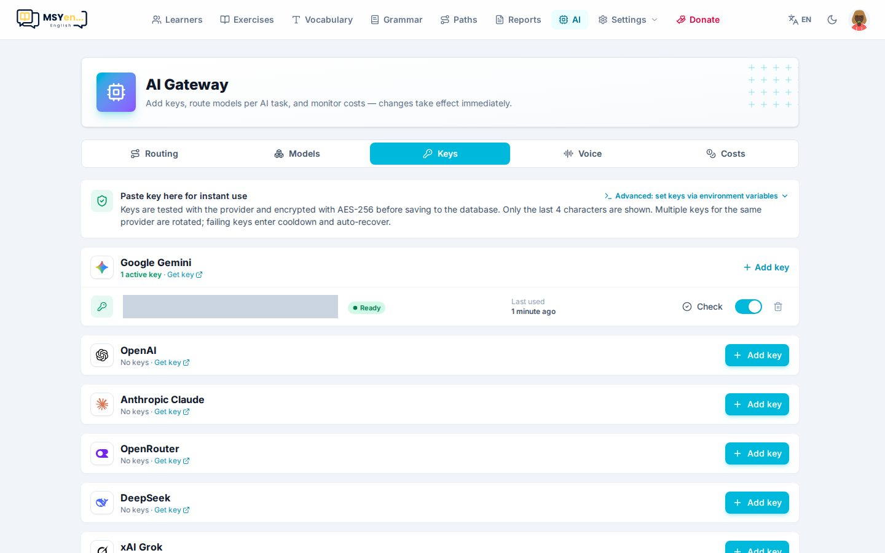
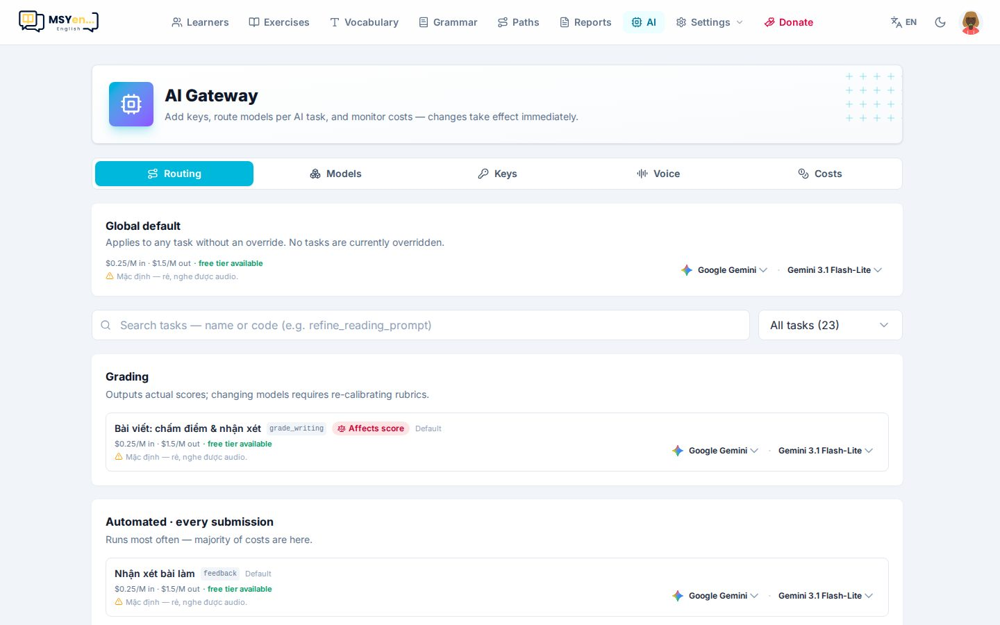
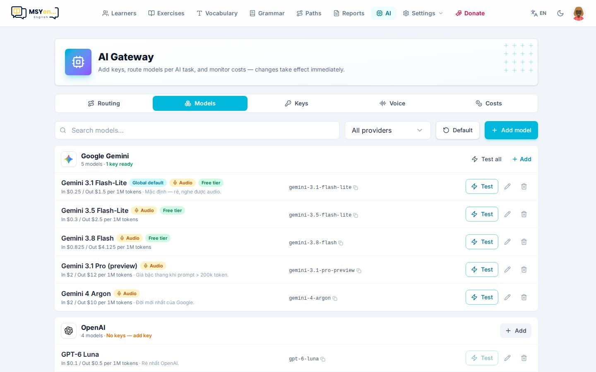
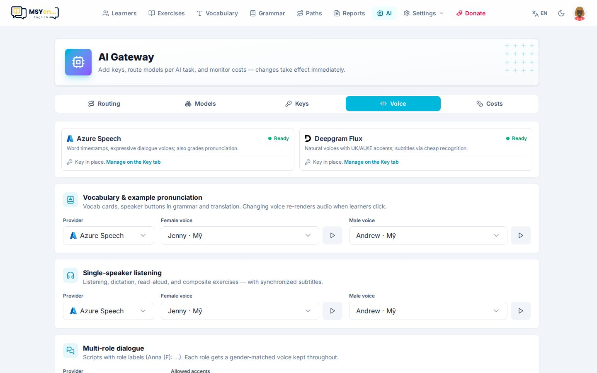

# 3. Cổng AI

Mọi tính năng AI (tạo bài, chấm bài viết, nhận xét, báo cáo tháng, giọng đọc…) đi qua **Cổng AI**. Mở
**AI** trên thanh trên cùng. Thay đổi có hiệu lực ngay, không cần deploy lại.

Trang có 5 tab: **Định tuyến** (*Routing*), **Model** (*Models*), **Key** (*Keys*), **Giọng đọc** (*Voice*),
**Chi phí** (*Costs*).

## Key — việc đầu tiên cần làm

1. Chọn nhà cung cấp (Google Gemini, OpenAI, Anthropic Claude, OpenRouter, DeepSeek, xAI Grok), bấm
   **Lấy key** (*Get key*) để mở trang tạo key của họ.
2. Quay lại, bấm **Thêm key** (*Add key*), dán key vào.
3. App thử key với nhà cung cấp rồi mới lưu. Key được **mã hoá AES-256** trong cơ sở dữ liệu, chỉ hiện
   4 ký tự cuối.

Mẹo:

- **Google Gemini có gói miễn phí** — đủ để bắt đầu.
- Thêm nhiều key cho cùng một nhà cung cấp: app tự xoay vòng, key lỗi tạm nghỉ rồi tự hồi phục.
- Nút **Kiểm tra** (*Check*) thử lại key; công tắc bật/tắt key mà không xoá.

## Định tuyến — model nào làm việc gì

- **Mặc định chung** (*Global default*) áp cho mọi tác vụ chưa đặt riêng.
- Từng tác vụ (chấm bài viết, nhận xét bài làm, tạo bài, báo cáo tháng…) có thể chọn nhà cung cấp và
  model riêng. Mỗi dòng ghi giá theo triệu token và có gói miễn phí hay không.
- Tác vụ có nhãn **Ảnh hưởng điểm** (*Affects score*) cho ra điểm thật — đổi model ở đây có thể làm điểm
  của học viên lệch so với trước.

Gợi ý: dùng model rẻ/nhanh làm mặc định, chỉ đặt model mạnh hơn cho **chấm bài viết** và **tạo bài**.

## Model

Danh mục model mà phần Định tuyến được chọn. Thêm model mới của nhà cung cấp, thử model, hoặc xoá model
không dùng.

## Giọng đọc

Chọn nhà cung cấp giọng đọc (Azure, Deepgram) và giọng (Mỹ, Anh, Úc…) cho từng việc: đọc bài nghe, đọc từ
vựng, giọng mẫu phát âm. Chấm phát âm dùng Azure Speech — xem `docs/SPEECH.md` để cấu hình.

## Chi phí

Theo dõi số lần gọi và chi phí ước tính theo tác vụ và theo model, để biết tiền đang đi đâu.
