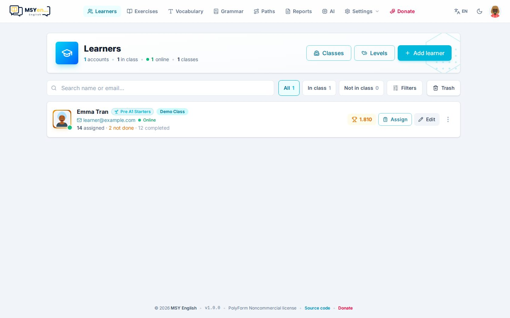
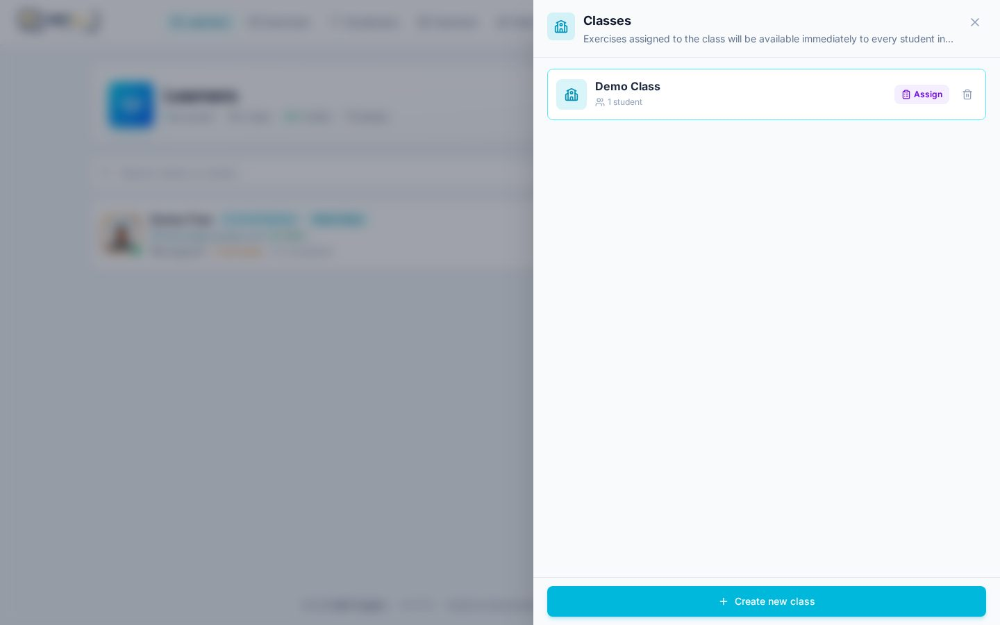
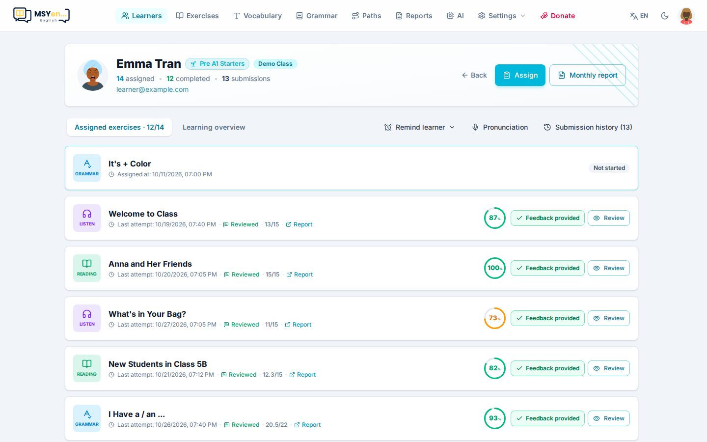

# 4. Học viên & lớp học

Mở **Học viên** (*Learners*). Học viên tự đăng ký (email hoặc Google) sẽ tự xuất hiện ở đây; bạn cũng có
thể tạo tài khoản cho em.

Phía trên là các nút **Lớp học** (*Classes*), **Cấp độ** (*Levels*), **Thùng rác** (*Trash*) và
**Thêm học viên** (*Add learner*). Ô tìm kiếm và các nút lọc (**Tất cả / Trong lớp / Ngoài lớp**,
**Bộ lọc**) giúp tìm nhanh.

## Cấp độ

Cấp độ (ví dụ *Pre A1 Starters*, *A1 Movers*) quyết định **lộ trình** em được mở và bộ từ vựng phù hợp.

- **Cấp độ** (*Levels*) → đặt tên, màu và biểu tượng → **Thêm cấp độ**.
- Xoá cấp độ chỉ gỡ cấp độ khỏi học viên, không xoá học viên.
- Học viên tự chọn cấp độ khi đăng ký lần đầu; bạn đổi được bất cứ lúc nào trong hồ sơ của em.

## Tạo học viên

**Thêm học viên** (*Add learner*) → nhập tên, email, mật khẩu (có thể để trống để app tạo), cấp độ, năm
sinh, giới tính. Bật **Thêm vào lớp học** để xếp lớp luôn.

> Mật khẩu chỉ hiện **một lần** sau khi tạo — hãy chép lại gửi cho em.

## Lớp học

Lớp là cách nhóm học viên để **giao bài cho cả lớp một lần**.

- **Lớp học** → **Tạo lớp mới** (*Create new class*).
- Bấm vào lớp để xem thành viên, thêm em (tìm theo tên/email, hoặc gõ email mới để tạo luôn tài khoản).
- Nút **Giao** (*Assign*) trên mỗi lớp mở danh sách bài để giao.
- Bài giao cho lớp **mở ngay** cho mọi em trong lớp, không phụ thuộc cấp độ hay lịch mở dần của lộ trình.

## Hồ sơ từng học viên

Bấm vào một học viên để mở trang của em.

- **Bài được giao** (*Assigned exercises*): từng bài với trạng thái, điểm, lần làm gần nhất; nút
  **Nhận xét** (*Give feedback*) và **Xem bài** (*Review*).
- **Tổng quan học tập** (*Learning overview*): điểm mạnh, điểm yếu theo kỹ năng, chuỗi ngày học.
- **Nhắc học** (*Remind learner*): soạn sẵn tin nhắn liệt kê bài em chưa làm hoặc làm chưa đạt, chép vào
  clipboard để bạn dán gửi qua Zalo / Messenger.
- **Phát âm** (*Pronunciation*): các lần đọc to và điểm phát âm.
- **Lịch sử nộp bài** (*Submission history*): mọi lượt nộp.
- **Giao bài** (*Assign*) giao riêng cho em; **Báo cáo tháng** (*Monthly report*) tạo báo cáo cho phụ huynh.

Menu ⋮ trên mỗi dòng ở danh sách: **Hồ sơ tài khoản** (sửa thông tin, đặt lại mật khẩu), **Khoá / Mở khoá**
(em không đăng nhập được khi bị khoá), **Xoá tài khoản** (vào Thùng rác, khôi phục được).
