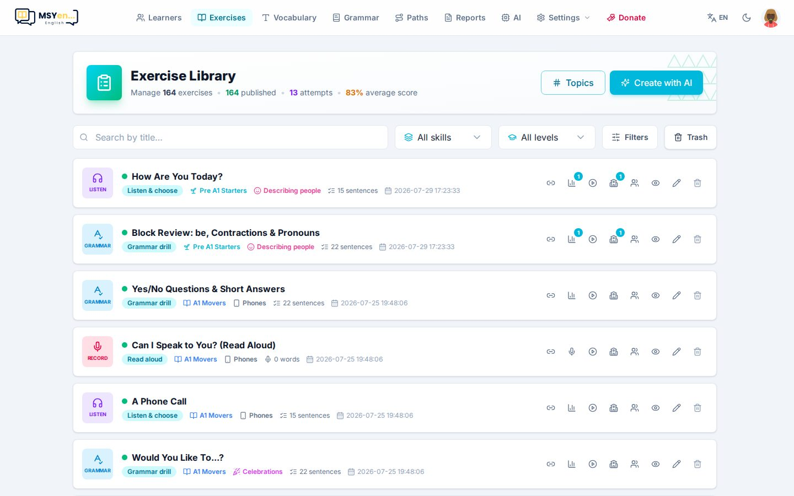
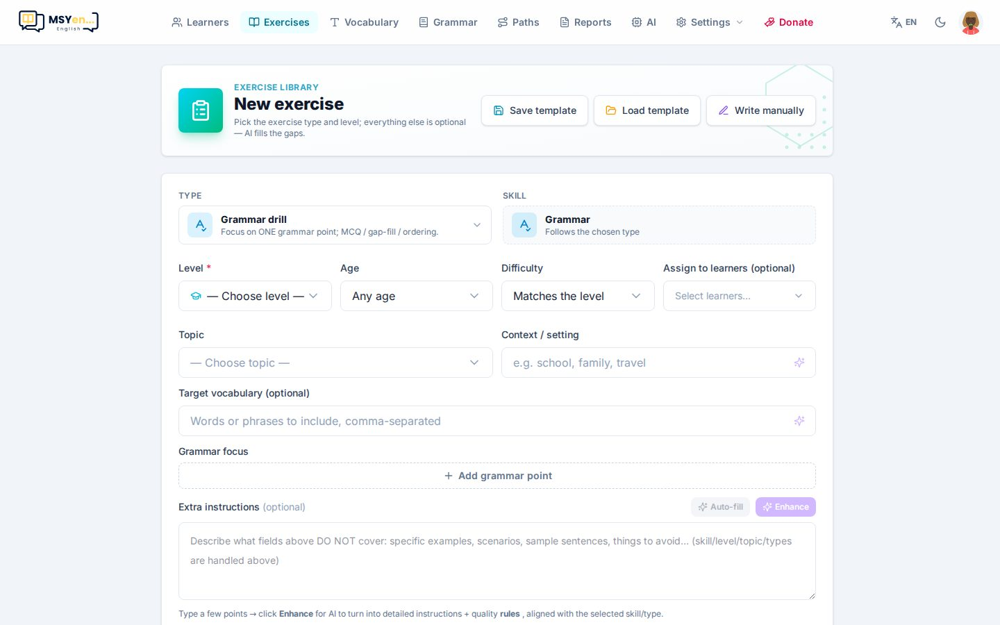
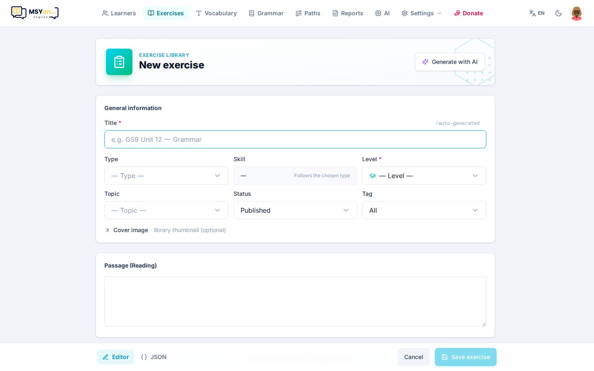

# 5. Soạn bài

Mở **Bài tập** (*Exercises*) — thư viện mọi bài đã tạo.

- Tìm theo tên, lọc theo kỹ năng, cấp độ; **Bộ lọc** (*Filters*) có thêm trạng thái, chủ đề, nhãn.
- **Thùng rác** (*Trash*) nằm cạnh Bộ lọc: bài đã xoá vẫn khôi phục được (về dạng nháp) hoặc xoá hẳn.
- **Chủ đề** (*Topics*) quản lý cây chủ đề dùng để phân loại bài.
- Hàng chờ AI hiện phía trên danh sách khi có bài đang được tạo.

## Tạo bài bằng AI (nhanh nhất)

Bấm **Tạo bài AI** (*Create with AI*).

1. Chọn **Kỹ năng** và **Dạng bài** (template). Mỗi dạng bài quyết định cấu trúc: có đoạn văn hay
   không, những dạng câu nào được dùng.
2. Chọn **Trình độ** (bắt buộc), **Độ tuổi**, **Độ khó**, và **Giao cho học viên** nếu muốn giao ngay.
3. (Tuỳ chọn) **Chủ đề**, **Ngữ cảnh**, **Từ vựng cần có**, **Trọng tâm ngữ pháp**.
4. **Hướng dẫn thêm** (*Extra guidance*): gõ vài ý rồi bấm **Enhance** — AI biến thành hướng dẫn chi tiết.
   **Tự điền** (*Auto-fill*) để AI gợi ý luôn ngữ cảnh và từ vựng.
5. **Tuỳ chọn nâng cao**: số câu, dạng câu, độ dài đoạn văn, giọng văn, ngôn ngữ phần giải thích.
6. Bấm **Tạo & lưu nháp** (xem lại trước) hoặc **Tạo & xuất bản** (học viên thấy ngay).

Bài được đưa vào **hàng chờ**: bạn quay về danh sách và làm việc khác, bài xong sẽ hiện trong thư viện.

Mẹo:

- **Lưu mẫu / Nạp mẫu** (góc phải trên) lưu toàn bộ lựa chọn để lần sau tạo bài tương tự chỉ một cú bấm.
- **Xem prompt** cho xem chính xác yêu cầu gửi cho AI.
- Bài **dịch câu** (*Grammar translate*): nên **Tạo & lưu nháp** để duyệt câu tiếng Việt và các cách dịch
  được chấp nhận trước khi giao.

## Soạn tay

Bấm **Soạn tay** (*Manual*) ở góc phải trên trang soạn bài.

- Điền tiêu đề, kỹ năng, dạng bài, cấp độ, chủ đề, nhãn; với bài đọc/nghe: đoạn văn, audio, ảnh.
- **Câu hỏi**: thêm từng câu theo 6 dạng — trắc nghiệm, điền từ, nối, sắp xếp, phân loại, dịch câu.
  **Kéo tay nắm ⠿** ở đầu câu để đổi thứ tự; mỗi câu có nút nhân bản và xoá.
- Có thể **Copy prompt** sang ChatGPT/Claude rồi dán JSON kết quả vào, hoặc sửa toàn bộ bài bằng JSON.
- Bài do AI tạo có nút **Tạo lại bằng AI** để quay về chế độ AI với đúng các lựa chọn cũ.
- Thanh dưới cùng: **Huỷ** và **Lưu bài**.

## Giao bài

Bấm nút giao trên một bài trong thư viện.

- Tab **Học viên**: chọn từng em.
- Tab **Lớp học**: bật để giao cho cả lớp — bài luôn mở, không theo cấp độ hay lịch mở dần.
- Tiêu đề drawer ghi luôn bài này đang được giao cho bao nhiêu em, bao nhiêu lớp.

Ngoài ra còn giao được từ trang **Lớp học** và trang **hồ sơ học viên**.
