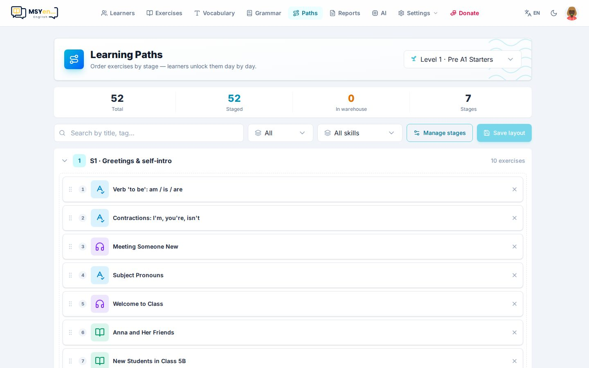

# 6. Lộ trình

**Lộ trình** (*Paths*) là con đường học hằng ngày cho học viên tự học: bài được sắp thành **chặng**, mỗi
ngày em được mở thêm bài mới, làm đạt thì mở tiếp. Thói quen học đều hình thành từ những bước nhỏ.

## Cách dùng

1. Chọn **cấp độ** ở góc phải trên — mỗi cấp có lộ trình riêng.
2. **Quản lý chặng** (*Manage stages*): thêm chặng (ví dụ "Tuần 1 · Chào hỏi"), đổi tên, kéo để đổi thứ tự.
3. Kéo bài vào chặng và sắp thứ tự bằng tay nắm ⠿; dấu × đưa bài ra khỏi lộ trình (bài vẫn còn trong thư viện).
4. Bấm **Lưu bố cục** (*Save layout*).

Các ô số ở trên cho biết: tổng số bài, số bài đã xếp vào chặng, số bài **trong kho** (thuộc cấp này nhưng
chưa xếp), số chặng.

## Lộ trình và bài giao — khác nhau thế nào

| | Lộ trình | Bài được giao |
|---|---|---|
| Ai thấy | Mọi học viên cùng cấp độ | Lớp hoặc em được giao |
| Khi nào mở | Mở dần theo ngày, làm đạt thì mở tiếp | Mở ngay |
| Dùng cho | Tự học đều đặn | Bài tập về nhà, kiểm tra |
