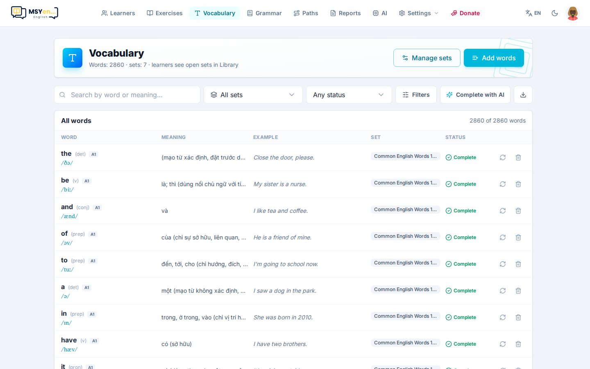
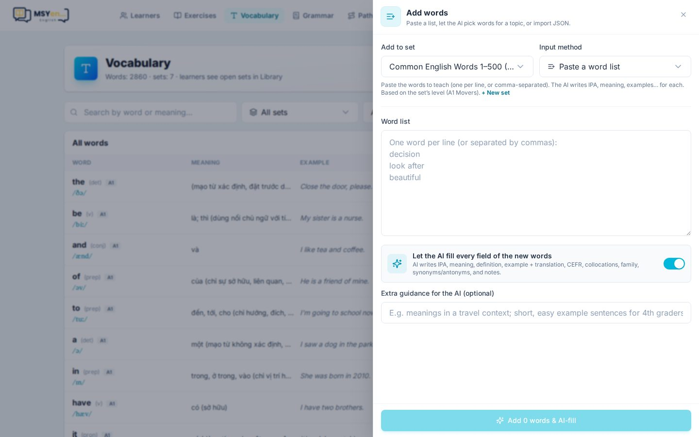

# 7. Từ vựng

**Từ vựng** (*Vocabulary*) quản lý các **bộ từ** để học viên luyện thẻ: flashcard và 7 dạng luyện (nối,
nghe chọn, chép chính tả, nhớ lại, phát âm, đánh vần, đồng nghĩa), với lịch ôn lặp ngắt quãng — từ nào
sắp quên thì gặp lại.

- Bảng **Tất cả từ** hiện từ, phiên âm IPA, nghĩa, ví dụ, cấp độ CEFR. Tìm theo từ hoặc nghĩa, lọc theo bộ.
- **Bộ từ vựng**: tạo, sửa, xoá bộ; bộ **đang mở** sẽ hiện cho học viên trong Thư viện.

## Thêm từ

Bấm **Thêm từ** (*Add words*).

Chọn bộ đích và **cách nhập**:

| Cách | Khi nào dùng |
|---|---|
| **Dán danh sách từ** (*Paste word list*) | Có sẵn danh sách — mỗi dòng một từ. Bật **AI điền mọi trường** để AI viết IPA, nghĩa, định nghĩa, ví dụ + dịch, CEFR, cụm từ, họ từ, đồng/trái nghĩa |
| **AI tạo theo chủ đề** (*AI generate by topic*) | Chưa có danh sách — cho AI chọn từ theo chủ đề và cấp độ |
| **Nhập JSON** (*Import JSON*) | Đã có dữ liệu đầy đủ từ nguồn khác |

**Hướng dẫn thêm cho AI** giúp AI viết đúng ý, ví dụ "nghĩa trong ngữ cảnh du lịch; câu ví dụ ngắn cho học
sinh lớp 4".

Mỗi từ có thể mở ra để sửa từng trường, hoặc nhờ AI **hoàn thiện** các trường còn thiếu.
