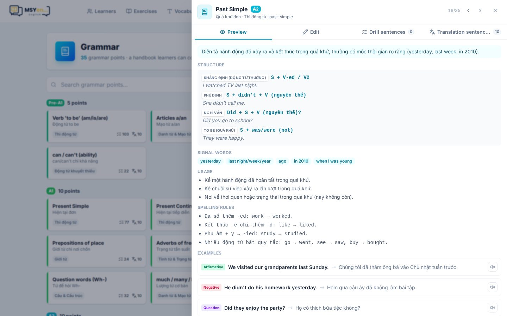
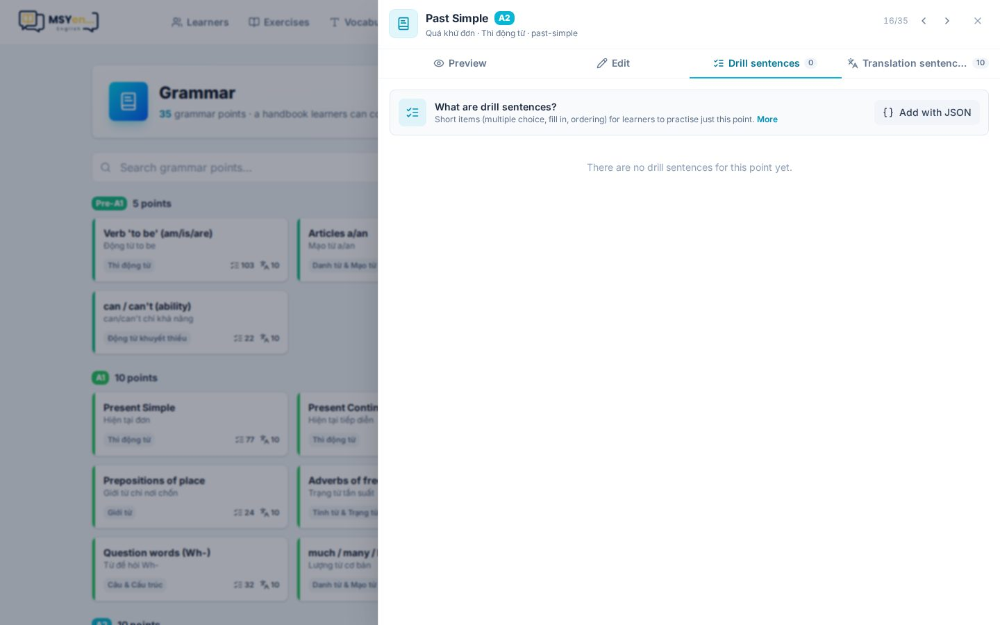
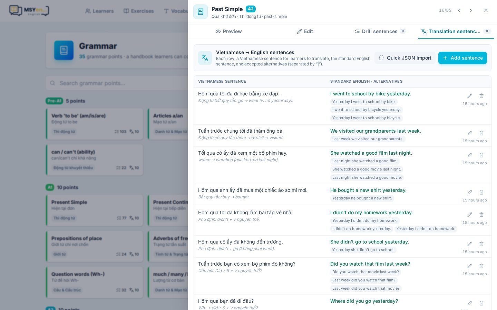

# 8. Ngữ pháp

**Ngữ pháp** (*Grammar*) là sổ tay các điểm ngữ pháp theo cấp CEFR. Học viên đọc sổ tay, luyện trắc nghiệm
và luyện dịch câu theo từng điểm.

Bên trái là danh sách điểm (tìm kiếm, lọc theo cấp); bên phải là điểm đang chọn với các tab.

## Xem trước & soạn điểm ngữ pháp

- **Xem trước** (*Preview*): đúng như học viên thấy — công thức, cách dùng, ví dụ song ngữ, dấu hiệu nhận
  biết, lỗi hay gặp, mẹo nhớ.
- **Soạn điểm mới** (*Compose new point*) hoặc sửa điểm có sẵn bằng biểu mẫu; phần nâng cao sửa bằng JSON.

## Câu drill

Ngân hàng câu ngắn (trắc nghiệm, điền từ, sắp xếp) để học viên luyện riêng điểm này. Mỗi buổi luyện lấy
ngẫu nhiên vài câu, ưu tiên câu em hay sai.

- **Tự động từ bài tập**: khi lưu một bài kỹ năng Grammar, AI gắn điểm ngữ pháp cho từng câu và chép câu vào
  đây. Muốn sửa câu đó, sửa trong bài gốc (bấm tên bài).
- **Thêm bằng JSON**: chép prompt sang ChatGPT/Claude, dán kết quả vào.
- Câu thêm tay sửa được ngay tại chỗ (biểu tượng bút chì). Mỗi câu ghi **thời gian thêm**, câu mới ở trên.

## Câu dịch

Câu tiếng Việt để học viên dịch sang tiếng Anh, luyện ở trang Ngữ pháp → **Dịch câu**.

- Mỗi câu gồm: câu tiếng Việt, câu tiếng Anh chuẩn, **các cách dịch khác được chấp nhận** (ngăn bằng `|`),
  ghi chú hiện sau khi chấm.
- Bấm vào câu để sửa, **Nhập nhanh JSON** để thêm nhiều câu, rồi **Lưu câu dịch**.

Khi viết câu dịch, lưu ý:

- **Đánh dấu thì** trong câu tiếng Việt (đã, rồi, sẽ, hôm qua, tuần trước…) — tiếng Việt không chia thì.
- Dùng đại từ rõ nghĩa: *cô ấy* → she, *anh ấy* → he; tránh *bạn ấy*.
- Không cần liệt kê biến thể chỉ khác hoa/thường, dấu câu, viết tắt (`didn't` = `did not`) hay a/an/the —
  app đã tự bỏ qua. Chỉ cần thêm từ đồng nghĩa (bike/bicycle) và cách đặt trạng từ khác.
