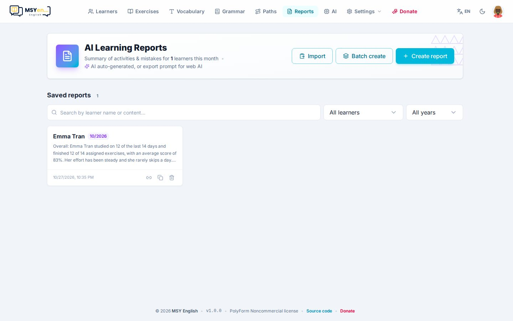
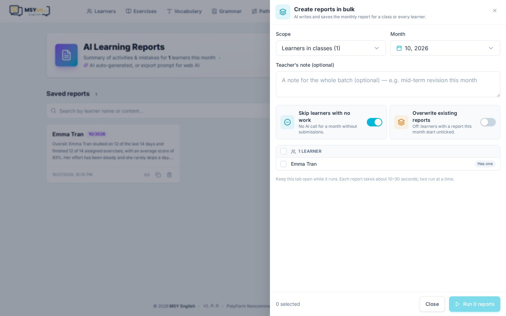

# 9. Chấm bài & báo cáo

## Ai chấm gì

| Dạng bài | Chấm thế nào |
|---|---|
| Trắc nghiệm, điền từ, nối, sắp xếp, phân loại, dịch câu | App chấm ngay khi nộp |
| Đọc to | Azure Speech chấm phát âm từng âm |
| Viết | AI chấm 4 tiêu chí (Nội dung · Bố cục · Từ vựng · Ngữ pháp), kèm nhận xét |
| Từ vựng | Theo tiến bộ trí nhớ của từng từ |

Đáp án **không bao giờ gửi về máy học viên** trước khi nộp.

## Nhận xét AI

Khi học viên nộp bài, AI viết **nhận xét** riêng cho bài đó, xưng hô theo cài đặt Cô/Thầy. Trang kết quả của
em tự cập nhật khi nhận xét xong.

- Bài nào tạo nhận xét bị lỗi sẽ được thử lại tự động (bài của lớp, trong 3 ngày gần nhất).
- Bật **Báo khi có nhận xét mới** ở Cài đặt → Telegram để nhận từng nhận xét về Telegram.

## Xem và sửa bài làm

Mở **hồ sơ học viên** → **Bài được giao** hoặc **Lịch sử nộp bài**:

- **Xem bài** (*Review*): từng câu, câu đúng/sai, đáp án của em.
- **Nhận xét** (*Give feedback*): viết hoặc sửa lời nhận xét; có thể nhờ AI viết lại.
- **Báo cáo** (*Report*): link báo cáo của bài, gửi được cho phụ huynh.

## Báo cáo tháng

Mở **Báo cáo** (*Reports*).

- **Tạo báo cáo** (*Create report*): chọn học viên và tháng — AI tổng hợp mọi bài em đã làm thành báo cáo:
  em đã làm gì, tiến bộ ở đâu, cần luyện thêm gì. Đọc lại, chỉnh nếu cần, rồi lưu.
- **Xuất prompt**: nếu muốn dùng ChatGPT/Claude bản web, copy prompt, dán vào đó, rồi **Import** kết quả —
  app tự nhận ra học viên và tháng.
- Mỗi báo cáo đã lưu có nút **chép link** để gửi phụ huynh, nút sao chép nội dung và nút xoá.

### Tạo hàng loạt

**Tạo hàng loạt** (*Batch create*) viết báo cáo tháng cho cả lớp hoặc mọi học viên một lần:

- **Bỏ qua học viên không có bài** — tháng không có bài nộp thì không gọi AI (không tốn tiền).
- **Ghi đè báo cáo đã có** — tắt thì người đã có báo cáo tháng này không bị chọn.
- Thêm một ghi chú chung cho cả đợt, ví dụ "tháng này ôn giữa kỳ".
