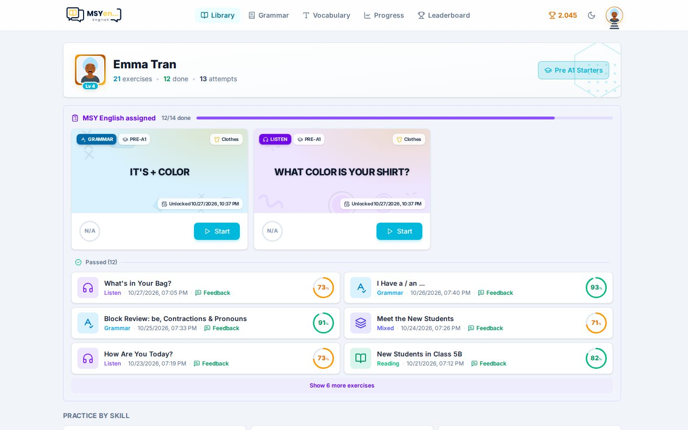
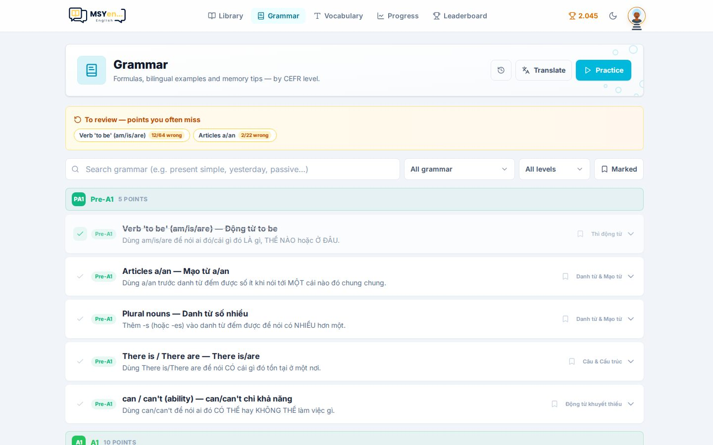

# 10. Học viên thấy gì

Biết học viên thấy gì giúp bạn hướng dẫn các em và giải thích cho phụ huynh.

## Thư viện

- Đầu trang: tên em, cấp độ, số bài đã làm.
- **Bài giáo viên giao** (*… assigned*): hàng chờ bài cần làm kèm thanh tiến độ; bên dưới là các bài đã
  làm, có điểm và nút xem **Nhận xét**.
- **Luyện theo kỹ năng** (*Practice by skill*) và lộ trình theo cấp độ, mở dần mỗi ngày.
- Thanh trên cùng: **Ngữ pháp**, **Từ vựng**, **Tiến độ**, **Bảng xếp hạng** và tổng điểm của em.

## Ngữ pháp

- Sổ tay ngữ pháp theo cấp độ, đánh dấu điểm đã học.
- **Luyện tập** (*Practice*): trắc nghiệm theo các điểm em chọn, ưu tiên điểm hay sai.
- **Dịch câu**: dịch câu tiếng Việt sang tiếng Anh với 4 mức gợi ý (Dễ → Khó nhất), chỉ dùng được với
  những điểm đã có câu dịch ([phần 8](08-ngu-phap.md#câu-dịch)).

## Sau khi nộp bài

Em thấy điểm ngay, từng câu đúng/sai kèm giải thích, rồi nhận xét của giáo viên (do AI viết) hiện lên sau
vài giây. Bài chưa làm xong được lưu nháp, mở lại trên máy khác vẫn tiếp tục được.
